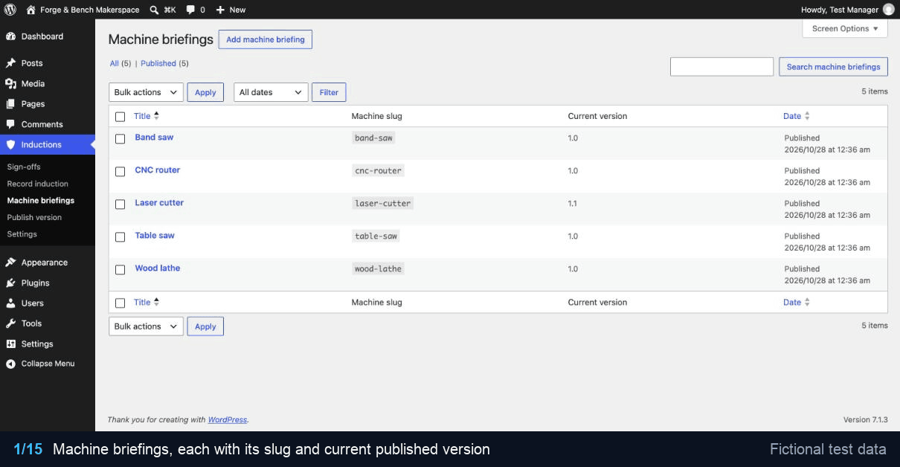

# Induction Records

WordPress plugin that Forge & Bench Makerspace uses to run machine safety inductions: versioned safety briefings, inductions recorded by a supervisor and confirmed by the member, PDF induction certificates, and a private certificate archive for every member.

## Walkthrough



The recording shows the machine briefings, version 2.0 of the laser cutter briefing published as a major change and the inductions it flags for re-induction, a supervisor recording a new induction, the paper records imported with WP-CLI, the certificate template, a supervisor being refused their own induction, and the member reading the new briefing, confirming it and opening the certificate PDF.

## The problem it solves

Inductions used to be paper forms in a binder. When the laser cutter briefing changed after an extraction fault, nobody could say who had been briefed on the old procedure, and members who lost their form had no way to show they had been inducted. The plugin keeps every briefing version, ties each induction to the exact version the member was briefed on, flags who needs re-induction when the safety content changes, and gives every member a certificate they can download at any time.

## Features

- **Machine briefings** (a private post type): the title is the machine name, the content is the safety briefing. Briefings are published as immutable versions (`major.minor`) with a change note and a SHA-256 checksum of the normalised body.
- **Two-step sign-off**: a supervisor records the induction (Inductions > Record induction); the member reads the briefing and confirms it on their inductions page.
- **Certificates**: confirming renders the certificate text from a merge-field template, stores the SHA-256 of that exact text, builds an A4 PDF with dompdf (embedded DejaVu Sans, makerspace header, footer with certificate number and hash, the briefing reproduced on the following pages), archives it and emails it to the member.
- **Re-induction**: publishing a new major version flags every existing induction on that machine; minor versions keep them valid.
- **Member page**: an "Inductions" tab in WooCommerce My Account, or the `[induction_records]` shortcode on sites without WooCommerce, where it loads a small stylesheet of its own. It lists inductions waiting for confirmation, current inductions, machines that need re-induction (with the change note) and earlier records, each with a download link.
- **WooCommerce Subscriptions gate** (optional): when Subscriptions is active, only members with an active subscription can be inducted.
- **Admin**: sign-off list filterable by machine and status, record-induction form, publish-version screen, "resend to member" action, settings.
- **WP-CLI import** of paper records, idempotent, with a dry run.
- **Uninstall** keeps all records unless the site owner opts in to deletion.

## Versions and re-induction

The briefing post is a working copy. **Inductions > Publish version** (or "Publish new version" on the briefing) takes a snapshot of the saved title and body, sanitised with `wp_kses_post()`, and stores it as a new row in the versions table. Rules:

| Situation | Result |
| --- | --- |
| First version of a briefing | Always `1.0` |
| Minor version | `1.2` → `1.3`. Refused if the title and normalised body are unchanged. Existing inductions stay valid. |
| Major version | `1.3` → `2.0`. Allowed even with unchanged text (a replaced machine). Every pending or confirmed induction on an earlier major version becomes **re-induction required**, in the same transaction as the new version. |

Versions are never edited in place: the code has no update path for them, and a briefing that has published versions can be trashed but not permanently deleted. The checksum ignores what a reader cannot see (line endings, indentation, editor comments, non-breaking spaces, whitespace around block elements) and changes with anything they can, including letter case and the space between two inline elements.

A sign-off moves through these statuses:

| Status | Meaning |
| --- | --- |
| `pending` | Recorded by a supervisor, waiting for the member to confirm |
| `confirmed` | Confirmed by the member; certificate issued |
| `reinduction_required` | A newer major version was published |
| `superseded` | The member has since been inducted again on that machine |

### Certificate template

Settings > Certificate text is HTML with merge fields. Values are HTML-escaped; the template itself is trusted (sanitised on save). Unknown fields and filters are printed exactly as typed so mistakes are visible, and the settings screen lists them as a warning.

| Fields | Filters |
| --- | --- |
| `organisation.name`, `certificate.id`, `member.display_name`, `supervisor.display_name`, `machine.name`, `machine.slug`, `briefing.version`, `briefing.checksum`, `briefing.published_at`, `briefing.change_note`, `inducted_at`, `confirmed_at` | `date`, `datetime`, `upper`, `lower`; a date format can follow a colon: `{{inducted_at\|date:Y-m-d}}` |

Dates use the site's date format and timezone.

## Storage and security

**Tables** (created with `dbDelta`, schema version in the `induction_records_schema_version` option, upgraded automatically on the first request after an update):

- `{prefix}induction_records_versions`: briefing post id, major, minor, title, body_html, body_checksum, change_note, published_at, published_by.
- `{prefix}induction_records_signoffs`: member_id, briefing_version_id, supervisor_id, inducted_at, member_confirmed_at, ip_address, user_agent, rendered_hash, pdf_path (relative), legacy_ref (nullable, unique), status, created_at.

All dates are stored in UTC.

**Archive**: certificates live in `wp-content/uploads/induction-records/<member folder>/<random>.pdf`. The member folder is the first 32 hex characters of an HMAC-SHA256 of the user id under a random site key (`induction_records_archive_key`); file names are 128-bit random. Paths contain no names, email addresses or user ids, and only paths in exactly that shape are accepted back from the database. Every archive folder gets an `.htaccess` that denies all access and an empty `index.php`. If uploads are offloaded to object storage (an `s3://`-style path), the archive stays on the local disk. On nginx, which ignores `.htaccess`, either deny the folder:

```nginx
location ^~ /wp-content/uploads/induction-records/ { deny all; }
```

or move the archive outside the web root with the `induction_records_archive_root` filter.

**Downloads** go through `admin-post.php?action=induction_records_download` with a per-user nonce. Only the member the certificate belongs to, or a user with `manage_inductions`, gets the file; it is streamed as an attachment with `X-Content-Type-Options: nosniff` and no-cache headers. The real file location is never sent to the browser.

**Capabilities**: `manage_inductions` (briefings, versions, all certificates, resend) and `record_inductions` (record inductions). Administrators get both on activation. Supervisors are usually members too, so `record_inductions` is granted per user with the "Can record machine inductions" checkbox on their profile.

Every form uses a nonce and a capability check, input is sanitised and output escaped. A confirmation stores the member's IP address (use the `induction_records_client_ip` filter behind a proxy) and user agent.

## Importing paper records

```
wp induction-records import <csv> --files=<dir> [--dry-run] [--format=table|csv|json|yaml]
```

The CSV needs a header row with these columns, in any order (extra columns are ignored):

| Column | Content |
| --- | --- |
| `legacy_ref` | Reference written on the paper form, unique per file, at most 64 characters |
| `member_email` | Email address of the member's account |
| `machine_slug` | Slug of the machine briefing (shown in the briefings list) |
| `inducted_on` | `2019-03-02`, `02/03/2019` (day first) or `2 March 2019` |
| `supervisor_email` | Email address of the supervisor's account |
| `scan_filename` | Scanned form in the `--files` folder, a plain `.pdf` file name |

Each row becomes a sign-off on the briefing version that was in force on the induction date (the latest version published on or before that day, in the site's timezone; records older than the version history map to version 1.0 and say so in the report). The scan is copied into the member's archive folder, and its status is `confirmed`, `reinduction_required` if a newer major version exists, or `superseded` if the member already holds a more recent induction on that machine.

The import is idempotent on `legacy_ref`: rows already imported are skipped, so it can be run again after fixing errors. Every row is validated on its own and all of its problems are reported together; a bad row never stops the run. `--dry-run` checks every row, including user, machine and scan lookups, and writes nothing:

```
$ wp induction-records import paper-inductions.csv --files=scans --dry-run
+-----+-------------+--------------+----------------------------------------------------+
| row | legacy_ref  | result       | detail                                             |
+-----+-------------+--------------+----------------------------------------------------+
| 2   | FB-2019-001 | would-create | laser-cutter 1.0, reinduction_required             |
| 3   | FB-2019-002 | would-skip   | already imported as IR-000014                      |
| 4   | FB-2020-003 | error        | no user account for member r.ashby@forgebench.test |
+-----+-------------+--------------+----------------------------------------------------+
Warning: Dry run: 1 would be created, 1 would be skipped, 1 with errors. Nothing was written.
```

The command exits with status 1 when any row has an error.

## Hooks

| Hook | Type | Use |
| --- | --- | --- |
| `induction_records_certificate_email_subject`, `_body` | filter | Certificate email (receives a `MemberMessage`) |
| `induction_records_confirmation_email_subject`, `_body` | filter | "Please confirm your induction" email |
| `induction_records_email_headers` | filter | Headers for both emails |
| `induction_records_require_active_subscription` | filter | Return `false` to switch the Subscriptions gate off |
| `induction_records_member_is_eligible` | filter | Decide who can be inducted |
| `induction_records_archive_root` | filter | Archive location |
| `induction_records_member_page_url` | filter | Inductions page linked from emails |
| `induction_records_member_template` | filter | Member page template (themes can also copy `templates/member-inductions.php` to `induction-records/member-inductions.php`) |
| `induction_records_client_ip` | filter | IP address stored with a confirmation |
| `induction_records_version_published` | action | After a version is published, with the flagged sign-off ids |
| `induction_records_induction_recorded`, `_induction_confirmed` | action | After a supervisor records / a member confirms |
| `induction_records_certificate_incomplete` | action | A certificate was issued with unknown merge fields |
| `induction_records_error` | action | Unexpected errors (also written to the PHP error log) |

## Requirements

- PHP 8.1 or later with `dom` and `mbstring`
- WordPress 6.4 or later
- Composer, to install dompdf
- Optional: WooCommerce (My Account tab), WooCommerce Subscriptions (eligibility gate)

## Installation

1. Put the plugin in `wp-content/plugins/induction-records` and run `composer install --no-dev --optimize-autoloader` there.
2. Activate it. Administrators get both capabilities.
3. Add a machine briefing per machine, then publish version 1.0 of each under Inductions > Publish version.
4. Tick "Can record machine inductions" on each supervisor's profile.
5. With WooCommerce, members find the Inductions tab in My Account. Without it, add `[induction_records]` to a page and select that page under Inductions > Settings.

## Development

```
composer install
vendor/bin/phpunit                                  # unit tests, no WordPress needed
vendor/bin/phpcs                                    # WordPress coding standards
vendor/bin/phpstan analyse --memory-limit=1G        # static analysis against WordPress stubs
```

The unit tests use PHPUnit 11 and Brain Monkey. They cover version numbering and bump rules, checksum normalisation, merge-field rendering and escaping, re-induction rules, the member page grouping, CSV reading, row validation and version mapping for the import, archive path derivation and storage, certificate HTML and PDF output, the mailer and its filters, and the Subscriptions gate. Code is laid out PSR-4 under `src/` (`ForgeBench\InductionRecords`); classes that need no WordPress (versioning, rendering, PDF, archive paths, import parsing) have no WordPress calls so they can be tested directly.

## Uninstalling

Deleting the plugin keeps every table, option, briefing and certificate file, because induction records are a safety audit trail. To remove everything, tick "Delete all induction data when the plugin is deleted" under Inductions > Settings first. On a multisite network the setting is honoured per site.

## License

GPL-2.0-or-later
